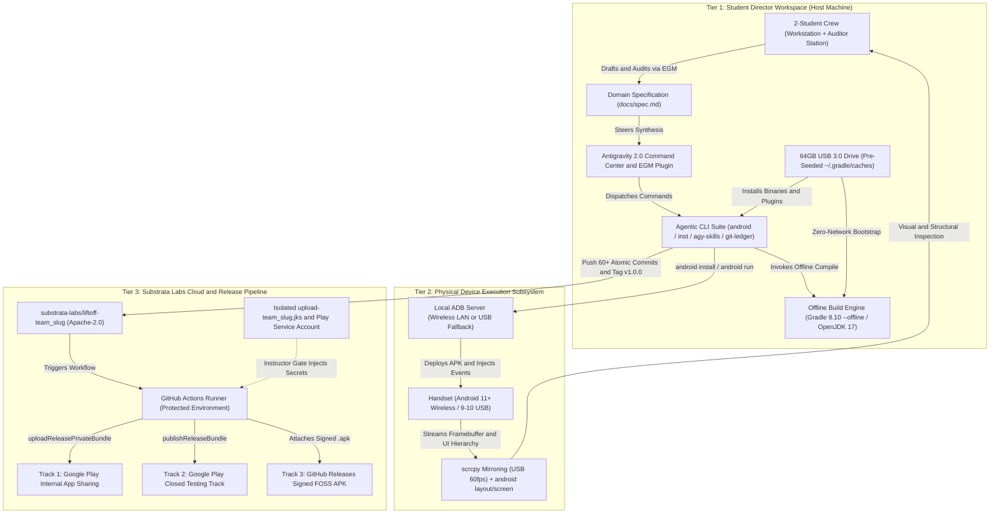
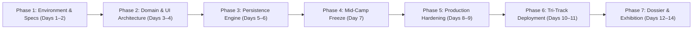

# Liftoff Zero-to-One: 2-Week Winter Agentic Android Engineering Bootcamp

* **Author:** Kush Chouhan (@kush-chou)
* **Status:** Approved
* **Date:** 2026-10-25
* **Methodology:** Elephant-Goldfish Model (EGM)

--------------------------------------------------------------------------------

## Overview

Liftoff Zero-to-One is a 14-day residential winter engineering bootcamp piloted at Mayo College, Ajmer, for high school students in Grades 9–12. The program teaches agentic software engineering using Antigravity 2.0 and the Elephant-Goldfish Model (EGM), training students to direct autonomous AI coding agents to specify, test, compile, verify, and release production-grade Android software.

Students progress from initial architectural specifications (`docs/spec.md`) to a signed Android App Bundle (`.aab`) and signed release APK (`.apk`) deployed via a Tri-Track release pipeline under the Substrata Labs organization developer profile (`github.com/substrata-labs`). Using native Kotlin, Jetpack Compose, and SQLite/Room managed through a terminal-first, agent-native Android toolchain (`android` CLI `v1.0.16625370`, `inst` `v0.1.0`, `agy-skills` `v0.1.0`, `git-ledger`, Gradle, ADB, and `scrcpy`), student crews direct Antigravity 2.0 to generate, refactor, and test local-first utilities tailored to boarding school campus life.

Each cohort produces three verifiable engineering deliverables: a public GitHub repository with a 60+ atomic commit DAG documenting student-agent co-authorship, an **In-App Identity Colophon & Build Fingerprint Screen**, and signed release binaries deployed across Google Play (Internal App Sharing and Closed Testing tracks) and GitHub Releases under an age-18 custodial IP transfer agreement.

--------------------------------------------------------------------------------

## The Problem

Conventional introductory programming curricula and student bootcamps present specific structural limitations:

1. **Syntax-Centric Instruction**: Curricula prioritize manual syntax memorization, loop mechanics, and semicolon placement over system architecture, state modeling, and end-to-end software delivery. Beginners spend instructional time troubleshooting trivial compile errors rather than learning architectural invariants.
2. **Absence of Structured Agentic Workflows**: While AI coding agents are transforming software engineering, students typically interact with LLMs via unstructured copy-paste chat interfaces. They lack experience with formal agentic workflows: spec-driven engineering, zero-context adversarial spec auditing (the Elephant-Goldfish Model), context token budgeting, read-only diff auditing, and red-to-green verification loops.
3. **Lack of Verifiable Contribution Provenance**: Standard student software projects lack version-controlled attribution proving authentic design ownership, obscuring whether code was copied from tutorials, generated indiscriminately by LLMs, or systematically architected, verified, and audited by the student.
4. **Environment and Bandwidth Fragility**: Traditional Android IDEs (Android Studio) and virtual device emulators exceed the memory capacity of consumer 8GB RAM laptops, cause thermal throttling, and require 6–10 GB of bandwidth per machine, which residential campus networks cannot sustain simultaneously.
5. **Publishing and Legal Barriers**: Google Play Console mandates 14 days of closed testing with 20 continuous testers for personal accounts, blocking individual student releases. Furthermore, publishing minor-authored software requires strict compliance with Section 9 of India's Digital Personal Data Protection (DPDP) Act 2023, COPPA, and intellectual property protection without leaking minor personal data.

Liftoff Zero-to-One addresses these constraints by pairing Antigravity 2.0 and the Elephant-Goldfish Model (EGM) with an offline-first, USB-provisioned local Android toolchain and an organization-level release pipeline.

--------------------------------------------------------------------------------

## Goals

* **Agentic Software Engineering (EGM + Antigravity 2.0)**: Direct software construction using Antigravity 2.0 and the Elephant-Goldfish Model (`google/elephant-goldfish-model`): authoring declarative specifications with full-context Elephant agents (`/egm-brainstorm`, `/egm-draft`), stress-testing specs with stateless zero-context Goldfish subagents (`/egm-review`), enforcing a 20,000 active token cap via `agy-skills`, auditing diffs with `git-ledger`, and executing deterministic red-to-green verification loops.
* **Environment Zero Determinism**: 100% of student laptops provisioned within the first 2 hours of Day 1 via pre-flashed 64GB USB 3.0 flash drives containing all binaries and a pre-seeded offline Gradle cache (`~/.gradle/caches/modules-2/`), ensuring zero campus Wi-Fi bandwidth is required for toolchain bootstrap or local compilation.
* **Canonical 28.0 Lab Hour Residency**: 14-day residency structured around **28.0 dedicated lab hours** (2.0 hours/day, 18:00–20:00 evening prep/lab slot integrated with Mayo College's daily routine) supplemented by structured weekend deep-work sprints for architectural documentation and peer reviews.
* **First Spec to Signed AAB (Tri-Track Release)**: Each 2-student crew (10 crews, 20 students total) directs Antigravity 2.0 to build, sign, and deploy an original, native Android utility (`.aab` and `.apk`) to **Track 1 (Google Play Internal App Sharing)** and **Track 3 (GitHub Releases FOSS APK)** by Day 11, and to **Track 2 (Google Play Closed Testing Track for pre-registered school emails)** by Day 13, with public Production promotion managed asynchronously post-camp.
* **Verifiable Agentic DAG Portfolio**: Every crew creates a public Apache-2.0 repository under the `substrata-labs` GitHub Organization (mirrored to each student's personal GitHub profile) showcasing **60+ atomic commits** with `git-ledger` Confidence 1.0 attribution trailers (`Agent: antigravity`, `Model: <model>`, `Co-authored-by: <handle>`, `Prompted-by:`, `Audited-by:`), comprehensive design specifications (`docs/spec.md`), an **In-App Identity Colophon & Build Fingerprint Screen**, and a 3-minute technical walkthrough video.
* **Deterministic Offline Architecture**: 100% local-first data persistence using SQLite/Room; zero cloud backend dependencies, tracking, or remote egress (`android.permission.INTERNET` stripped and verified at build time).
* **Controlled Organization Publishing**: All applications published under unique namespaces (`ai.substrata.liftoff.<team_slug>`) via Substrata Labs' organization console using per-crew isolated upload keystores (`upload-<team_slug>.jks`) stored in a protected GitHub Environment (`production-release`), preventing student machine exposure to signing credentials.
* **Child Safeguarding & DPDP Compliance**: Complete sanitization of minor personal identifiable information (PII) from public artifacts. Real names, physical residential boarding houses, and personal contact emails are strictly excluded from compiled binaries, public commit trailers, and Git repositories, using pseudonymized developer handles exclusively. Formal legal assent and parental co-signing are executed under Section 9 of the DPDP Act 2023.
* **On-Campus Demo Day**: Live campus exhibition at Mayo College on Day 14 where students demonstrate their apps to the Principal, Housemasters, faculty, and peers via direct Tri-Track QR installations.

--------------------------------------------------------------------------------

## Non-Goals

* **Manual Syntax Instruction**: No teaching students how to manually write Kotlin loops, syntax grammar, or manual UI layout code from scratch; students direct Antigravity 2.0 to synthesize the code against verified specifications.
* **Cloud Infrastructure & Remote Backends**: No cloud databases (Firebase, Supabase), remote REST APIs, or server management.
* **User Authentication & Analytics**: No user login flows, in-app OAuth, tracking SDKs, or remote telemetry collection.
* **Monetization & Commercial SDKs**: Complete omission of Google Play Billing, payment integrations, and ad mediation libraries.
* **Virtual Emulation Mandate**: No mandatory Android Virtual Device (AVD) emulator execution on student host machines; physical device deployment over Wireless ADB / USB ADB is the primary execution path.

--------------------------------------------------------------------------------

## Open Questions (Resolved)

* **Question 1 (Antigravity Connectivity, OAuth & Token Routing) — RESOLVED**:
  * *Resolution*: Decentralized model access via parent/guardian-owned 18+ Google Accounts (or institutional Substrata Labs Google Workspace seats) subscribed to the **Google AI Pro plan** (Google One AI Premium) co-signed under the DPDP Act 2023 parental consent framework. On Day 1, students authenticate Antigravity 2.0 Desktop via its built-in interactive browser OAuth flow (`Sign in with Google` / `agy auth login`), which stores a local OAuth session token without exposing raw Gemini API keys. Quotas refresh every 5 hours, and students enforce a strict 20,000 active token cap via `agy-skills` to prevent mid-session quota exhaustion during 2.0-hour evening lab sessions.
  * *Physical Network Autonomy*: Substrata Labs deploys a portable dual-SIM enterprise cellular router (with dual-carrier failover: Jio 5G + Airtel 5G, and **AP/Client Isolation disabled** on the `192.168.1.0/24` subnet) to handle Antigravity 2.0 LLM API requests and local Wireless ADB pairing without relying on Mayo College campus Wi-Fi.

* **Question 2 (Crew Division of Labor & Workstation Topology) — RESOLVED**:
  * *Resolution*: Standardized **Ping-Pong Agentic Pairing Protocol** operating across 2-student crews (10 crews / 20 students):
    * **Workstation Topology**: Each crew designates **Laptop 1 as the primary Crew Workstation** running Antigravity 2.0, Gradle Daemon, and ADB for the full 14 days, permanently paired with the crew's physical Android handset. **Laptop 2 functions as the Auditor Station**, dedicated to drafting specifications (`docs/spec.md`), reviewing pull requests, inspecting read-only diffs via `git-ledger`, and observing real-time UI mirroring.
    * **Hour 1 (18:00–19:00)**: Student A serves as **Lead Architect** on Laptop 1 (`docs/spec.md`, `/egm-draft`, `/egm-review`, Antigravity 2.0 steering); Student B serves as **Systems Auditor** on Laptop 2 (`git ledger --diff`, `./gradlew testDebugUnitTest verifyZeroEgress`, `android layout`, `scrcpy`).
    * **Hour 2 (19:00–20:00)**: Roles invert. Student B moves to Laptop 1 as Lead Architect; Student A takes Laptop 2 as Systems Auditor.
    * **1-Command Identity Swap**: The crew executes `bash scripts/crew-swap.sh` on Laptop 1, which switches local Git config (`user.name`, `user.email`) and attribution metadata in under 3 seconds without re-pairing hardware or pushing unverified code.
    * *Enforcement*: Standardized Git commit trailers verified by `git-ledger` at Confidence 1.0 (`Agent: antigravity`, `Model: <model>`, `Co-authored-by: <handleA>`, `Co-authored-by: <handleB>`, `Prompted-by: <handle>`, `Audited-by: <handle>`), requiring a balanced commit distribution across both crew members.

--------------------------------------------------------------------------------

## Critical User Journeys (CUJs)

### CUJ 1: Environment Zero Setup (Antigravity 2.0 + Custom Agentic Toolchain)
* **Given**: A student arrives on Day 1 with a personal Windows 11 Home or macOS laptop (8GB RAM), default restricted script execution policies, and zero campus Wi-Fi connectivity.
* **When**: The student connects the provided 64GB USB 3.0 flash drive and executes the bootstrap script (`setup.bat` on Windows or `bash scripts/setup.sh` on macOS).
* **Then**: The script installs Antigravity 2.0 Desktop and extracts OpenJDK 17, Android SDK Command-Line Tools, the `android` CLI (`v1.0.16625370`), `inst`, `agy-skills`, `git-ledger`, `scrcpy`, the Google USB Driver, the offline EGM plugin bundle, and the pre-seeded Gradle cache locally in under 5 minutes without network downloads. The student then connects to the lab's 5G Wi-Fi network, completes browser OAuth authentication in Antigravity 2.0 Desktop, pairs the Android handset via Wireless Debugging (or USB fallback for Android 9/10), and executes `bash scripts/verify-env.sh` to confirm toolchain readiness within 15 minutes.

### CUJ 2: Spec-Driven Feature Implementation via EGM & Antigravity 2.0
* **Given**: A 2-student crew has drafted an architectural specification for a campus utility in `docs/spec.md` using `/egm-brainstorm` and `/egm-draft`, defining a `sealed interface UiState<out T>` and Room SQLite persistence, and resolved all findings flagged by zero-context Goldfish subagents via `/egm-review`.
* **When**: The Lead Architect checks the context budget (`agy-skills status --json` confirming `< 20,000` active tokens) and directs Antigravity 2.0 to implement the Room DAO and Compose screen against the local `liftoff-starter` template.
* **Then**: Antigravity 2.0 generates Kotlin/Compose code adhering to the spec, compiles and deploys the debug APK incrementally via `android run` / `./gradlew assembleDebug --offline`, and the Systems Auditor inspects the live view hierarchy (`android layout`), USB screen mirror (`scrcpy`), and read-only diff (`git ledger --diff`) before committing with sanitized attribution trailers.

### CUJ 3: Google Play Tri-Track Deployment via Protected GitHub Environment
* **Given**: A student crew reaches Day 10–11 with a feature-complete campus utility, passing automated verification checks (`./gradlew lintDebug testDebugUnitTest verifyZeroEgress`), `/egm-drift-report` alignment, and an updated **In-App Identity Colophon & Build Fingerprint Screen**.
* **When**: The crew pushes a signed release tag (`v1.0.0`) to their `github.com/substrata-labs/liftoff-<team_slug>` repository, and an instructor approves the deployment gate on the protected `production-release` GitHub Environment.
* **Then**: The GitHub Actions runner compiles `./gradlew bundleRelease assembleRelease`, signs the `.aab` and `.apk` using the crew's isolated keystore (`upload-<team_slug>.jks`), uploads the bundle to **Track 1 (Google Play Internal App Sharing)** via `./gradlew uploadReleasePrivateBundle` and **Track 2 (Google Play Closed Testing Track)** via `./gradlew publishReleaseBundle`, and publishes **Track 3 (Signed FOSS APK)** to GitHub Releases with installation QR codes ready for Day 14 Demo Day.

--------------------------------------------------------------------------------

## Technical Plan (Architecture)

### 1. High-Level System Architecture

The Liftoff Zero-to-One architecture divides operations into three strictly isolated tiers: the **Student Director Workspace** on the host laptop, the **Physical Device Subsystem** for instant local execution, and the **Substrata Labs Cloud Release Pipeline** for organizational publishing.



---

### 2. Core Agentic Toolchain & Methodology Glossary

The toolchain standardizes on six agentic tools and four Android build primitives pre-packaged on the 64GB USB 3.0 drive:

1. **Elephant-Goldfish Model (EGM) (`google/elephant-goldfish-model`)**:
   * *Purpose*: The primary software engineering methodology taught in the bootcamp, installed into Antigravity 2.0 from the USB bundle (`agy plugin install /liftoff-usb/plugins/elephant-goldfish-model`, upstream `https://github.com/google/elephant-goldfish-model`).
   * *Mechanism*: Separates specification authoring from adversarial design review:
     * **Full-Context Elephant Agents (`/egm-brainstorm`, `/egm-draft`)**: Collaborate with the student crew to explore domain constraints, produce `concepts_brief.md`, and draft the file-by-file technical specification (`docs/spec.md`).
     * **Stateless Zero-Context Goldfish Subagents (`/egm-review`)**: Spawned with isolated context containing only the written specification and zero conversational history. They audit the spec across four sequential gates—*Zoom-Out Architecture*, *Naive Reader Comprehension*, *Hostile Design Critic*, and *Implementation Readiness*—forcing students to eliminate unstated assumptions before writing code.
     * **Drift Verification (`/egm-drift-report`)**: Audits the implemented Kotlin source tree against `docs/spec.md` prior to feature freeze to verify 100% spec-to-code alignment.

2. **Antigravity 2.0 (`agy` / `antigravity`)**:
   * *Purpose*: Google's standalone agentic desktop command center (`antigravity-desktop-setup.exe` on Windows, `antigravity-desktop.dmg` on macOS) and companion CLI binary (`agy` / `antigravity`), decoupled from heavy traditional IDEs.
   * *Authentication*: Authenticates against each crew's parent-consented 18+ Google Account subscribed to **Google AI Pro** (Google One AI Premium) via an interactive browser OAuth session (`Sign in with Google` in the desktop app or `agy auth login` in the terminal). No raw Gemini API keys or billing credentials are ever stored in student repositories or environment variables.

3. **Android CLI (`android` `v1.0.16625370`)**:
   * *Purpose*: Google's modern, agent-native command-line interface for Android development (bundled at `~/.liftoff/toolchain/bin/android`; completely distinct from the deprecated pre-2017 Android SDK `tools/android` script).
   * *Core Subcommands*:
     * `android info`: Audits local JDK, Android SDK, ADB, and connected handset readiness.
     * `android init` & `android skills`: Installs Android-specific agent rules and Compose/Room skills into the workspace.
     * `android create`: Scaffolds deterministic Android module structures.
     * `android describe`: Emits machine-readable JSON metadata describing Gradle variants, source sets, and output APK/AAB paths so Antigravity 2.0 never guesses file locations.
     * `android install` & `android run`: Compiles and incrementally deploys debug APKs to the attached handset.
     * `android layout`, `android screen`, & `android input`: Captures live Accessibility/Compose UI hierarchy trees (XML/JSON), grabs framebuffer screenshots, and injects deterministic touch/swipe/key events on the physical phone for closed-loop agent verification.

4. **`inst` (`v0.1.0`)**:
   * *Purpose*: Deterministic AI-native package and runtime provisioner (`~/.liftoff/toolchain/bin/inst`).
   * *Core Subcommands*: `inst setup -y --json` reads workspace `.tool-versions` / manifest files to link pinned local runtimes deterministically; also supports `inst uv:<pkg>` and `inst brew:<pkg>` when online.

5. **`agy-skills` (`v0.1.0`)**:
   * *Purpose*: Context window and token budget guardian for Antigravity 2.0 (`~/.liftoff/toolchain/bin/agy-skills`).
   * *Core Subcommands*: `agy-skills status --json`, `agy-skills list -w --json`, `agy-skills enable <name> -w`, `agy-skills disable <name> -w`, and `agy-skills lint`.
   * *Operational Invariant*: Enforces a hard **20,000 active token cap** and **24 KB workspace rule ceiling** (`templates/liftoff-starter/.antigravity/rules.md`), preventing mid-session quota exhaustion during 2.0-hour evening lab sessions.

6. **`git-ledger`**:
   * *Purpose*: Strictly read-only (`GIT_OPTIONAL_LOCKS=0`), zero-network local Git audit CLI (`~/.liftoff/toolchain/bin/git-ledger`).
   * *Core Subcommands*: `git ledger --last --agents-only`, `git ledger --diff <hash>`, and `git ledger --json`.
   * *Operational Invariant*: Invoked by the Systems Auditor student during Ping-Pong pairing to inspect agent-generated diffs and verify commit trailers without acquiring `.git/index.lock`. Enforces **Confidence 1.0 attribution signals** using pseudonymized developer handles:
     ```text
     Agent: antigravity
     Model: gemini-2.5-pro
     Prompted-by: dev-handle-a <dev-handle-a@users.noreply.github.com>
     Audited-by: dev-handle-b <dev-handle-b@users.noreply.github.com>
     Co-authored-by: dev-handle-a <dev-handle-a@users.noreply.github.com>
     Co-authored-by: dev-handle-b <dev-handle-b@users.noreply.github.com>
     Co-authored-by: Antigravity <antigravity@google.com>
     ```

7. **Android Build & Hardware Verification Primitives**:
   * **`scrcpy` (`v3.1`, Screen Copy)**: Open-source, low-latency (sub-50ms) physical Android display mirroring tool that streams the handset display at 60fps over USB or Wi-Fi without requiring root access or an on-device companion app.
   * **`KSP` (`2.1.0-1.0.29`, Kotlin Symbol Processing)**: High-performance compile-time annotation processor used by Android Room (`room-compiler`) to generate type-safe SQLite DAO implementations at build time with zero runtime reflection overhead.
   * **`R8 / ProGuard`**: Android's built-in compile-time code shrinker, optimizer, and dead-code eliminator invoked during `./gradlew bundleRelease` and `./gradlew assembleRelease` to minimize binary size.
   * **`bundletool` (`1.17.2`)**: Google's official command-line utility used in CI and local verification to validate `.aab` (Android App Bundle) archives and simulate Google Play split-APK generation (`bundletool build-apks`).

---

### 3. Tier Details & Subsystem Mechanics

#### Tier 1: Student Director Workspace (Host Machine)
* **Antigravity 2.0 Standalone Command Center**:
  * Students operate **Antigravity 2.0**, the standalone desktop command center app paired with a lightweight text editor (Zed or VS Code) used strictly to author `docs/spec.md` and inspect diffs.
  * Operating without Android Studio's heavy IntelliJ indexing shell or virtual device emulator preserves host RAM, keeping the entire stack under the **2.5 GB memory budget** on 8GB laptops.
* **Parent/Guardian-Owned 18+ Account Onboarding & Browser OAuth (DPDP Compliant)**:
  * Under Google Terms of Service and Section 9 of the DPDP Act 2023, accounts are legally parent/guardian-owned 18+ Google Accounts (or provisioned as institutional Substrata Labs Google Workspace seats) subscribed to the **Google AI Pro plan** (Google One AI Premium).
  * On Day 1, students connect to the lab's dual-SIM enterprise router and click `Sign in with Google` in Antigravity 2.0 Desktop (or run `agy auth login`), completing a browser OAuth 2.0 PKCE login that caches a refresh token locally.
* **Workstation Pairing Topology & 1-Command Identity Swap (`crew-swap.sh`)**:
  * Each 2-student crew utilizes two machines with dedicated responsibilities:
    * **Laptop 1 (Crew Workstation)**: Hosts Antigravity 2.0, the active local Git working tree, Gradle daemon, and the ADB connection to the paired phone.
    * **Laptop 2 (Auditor Station)**: Hosts the spec editor, pull-request browser, read-only `git-ledger` audit clone, and `scrcpy` display mirror.
  * At the top of each hour (18:00 and 19:00), students swap seats physically at Laptop 1 and run `bash scripts/crew-swap.sh`. This script switches local Git config and `.git/.commit-template` in under 3 seconds, eliminating hardware re-pairing or branch rebasing.
* **Environment Zero Offline 64GB USB 3.0 Bootstrap & Pre-Seeded Gradle Cache**:
  * Every crew receives a pre-flashed **64GB USB 3.0 drive (`LIFTOFF_USB`)** containing the complete offline payload (~14.5 GB total):
    * `/liftoff-usb/installers/`: `antigravity-desktop-setup.exe` (Windows x64) and `antigravity-desktop.dmg` (macOS universal).
    * `/liftoff-usb/toolchain/`: Portable OpenJDK 17 (`jdk-17.0.13`), Android SDK Command-Line Tools (`cmdline-tools;13.0`, `platforms;android-35`, `build-tools;35.0.0`, `platform-tools`), `android` CLI (`v1.0.16625370`), `inst` (`v0.1.0`), `agy-skills` (`v0.1.0`), `git-ledger`, `scrcpy` (`v3.1`), and `bundletool` (`1.17.2`).
    * `/liftoff-usb/drivers/`: Google USB Driver (`google-usb-driver-r13.zip`) for Windows composite ADB driver installations.
    * `/liftoff-usb/plugins/`: Offline archive of `google/elephant-goldfish-model` (`egm-plugin-bundle.tar.gz`).
    * `/liftoff-usb/gradle-seed/`: Pre-warmed Gradle distribution (`wrapper/dists/gradle-8.10.2-bin/`) and complete offline dependency cache (`caches/modules-2/files-2.1/` and `modules-2/metadata-2.106/`) matching the dependencies in `liftoff-starter`.
  * **Offline Cache vs. Subnet Mirror Precedence**:
    * *Primary Path (100% Offline Disk Cache)*: `setup.ps1` and `setup.sh` unpack `/liftoff-usb/gradle-seed/` directly into `~/.gradle/wrapper/dists/` and `~/.gradle/caches/modules-2/`. Because every dependency is already cached on the local SSD, `./gradlew assembleDebug --offline` (`org.gradle.offline=true` in `gradle.properties`) compiles with zero network requests.
    * *Secondary Fallback (Instructor Subnet HTTP Mirror)*: Declared directly in `settings.gradle.kts` within `dependencyResolutionManagement.repositories`, active only when `-PuseSubnetMirror=true --no-offline` is passed.
* **RF Saturation Prevention & Wireless Debugging**:
  * To protect local airtime for Antigravity LLM API requests, **`scrcpy` display mirroring is mandated over USB data cable** (or capped at 2 Mbps @ 30fps if wireless).
  * Student handsets connect directly to the local lab Wi-Fi router subnet (`192.168.1.0/24`, AP isolation disabled) and pair via standard Android 11+ Wireless Debugging (`adb pair` / `adb connect`).
* **Hardcoded Host Memory Caps (`gradle.properties`)**:
  * Enforces `org.gradle.jvmargs=-Xmx1536m -XX:+UseG1GC`, `org.gradle.parallel=false`, and `org.gradle.offline=true`, guaranteeing total host memory remains under 2.5 GB RAM.

#### Tier 2: Physical Device Subsystem & Emergency Hardware Buffer
* **Hardware Pairing Invariant (Android/iOS Distribution)**:
  * Pre-camp intake inventories student hardware and enforces a pairing constraint across the 10 crews: each 2-student crew must include at least one student with an Android handset. Students with iOS devices are paired with an Android-owning co-founder.
  * **Android 9/10 USB Cable Fallback**: If a handset runs Android 9 or 10, the crew connects using certified USB data cables from the instructor kit.
* **On-Site Instructor Emergency Handset Buffer**:
  * The instructor kit includes **3 pre-configured Android 13+ reference handsets** (e.g., Pixel 6a / Galaxy A-series) pre-provisioned with developer options and wireless pairing keys as hot-spares.
* **Agent-Driven Inspection & Real-Time Display Mirroring**:
  * Students and Antigravity 2.0 deploy builds via `android run` / `adb install -r -d app/build/outputs/apk/debug/app-debug.apk`, inspect view trees via `android layout`, capture screenshots via `android screen`, and mirror video via `scrcpy`.

#### Tier 3: Cloud Release Pipeline, GitHub Org Governance & Play Store Deployment
* **`substrata-labs` GitHub Organization & Protected Environment Governance**:
  * All 10 crew repositories are created under the **`substrata-labs` GitHub Organization** (`github.com/substrata-labs/liftoff-<team_slug>`, licensed under Apache-2.0) from the `liftoff-starter` template.
  * Both students in the crew are granted GitHub Collaborator `Write` access to push feature branches and pull requests, and all commits reflect on their individual contribution graphs via personal forks.
  * **Secret Quarantine (`production-release` Environment)**: Student laptops never hold production keystores or Google Play API keys. Each repository configures a protected GitHub Actions Environment named **`production-release`** with **Required Reviewers (`substrata-instructors`)** enabled. The crew's isolated upload keystore (`TEAM_UPLOAD_KEYSTORE_BASE64`, `KEYSTORE_PASSWORD`, `KEY_ALIAS`, `KEY_PASSWORD`) and the Google Play service account (`PLAY_SERVICE_ACCOUNT_JSON`) are scoped strictly to the `production-release` environment.
* **Per-Crew Keystore Isolation**:
  * On Day 1, instructors generate an isolated Java KeyStore (`upload-<team_slug>.jks`) per crew and enroll it in Google Play App Signing for package `ai.substrata.liftoff.<team_slug>`. Transferring an app at age 18 transfers only that crew's isolated key, never exposing Substrata Labs' master organization key.
* **Demo Day Tri-Track Release Strategy**:
  * **Track 1 (Baseline IAS Track — Day 11)**: **Google Play Internal App Sharing** (`./gradlew uploadReleasePrivateBundle`). Bypasses the 14-day / 20-tester hold and automated review queues, returning an immediate Google Play install URL and QR code within 5 minutes.
  * **Track 2 (Closed Testing Track — Days 11–13)**: **Google Play Closed Testing Track** (`./gradlew publishReleaseBundle --track alpha`). Pre-registered school and parent accounts install directly from the Play Store via a web opt-in link. *(Note: Because Google Play App Review for new closed testing tracks typically requires 3–7 business days, Track 2 is an asynchronous milestone; Track 1 and Track 3 provide guaranteed zero-friction installation for Day 14 Demo Day attendees).*
  * **Track 3 (Instant FOSS APK Fallback — Day 11)**: **GitHub Releases Signed APK**. The workflow attaches `app-release-signed.apk` directly to the repository's GitHub Release (`v1.0.0`), providing a zero-Play-Store QR fallback for any attendee.
  * **Hosted Privacy Policy**: Substrata Labs hosts a standardized, compliant privacy policy for all student apps at `https://substrata.ai/legal/liftoff-privacy` satisfying Google Play Console submission requirements.
* **Age-18 Co-Founder Split & Custodial Transfer Workflow**:
  * Students retain Day-1 copyright under Apache-2.0 while Substrata Labs holds the Google Play listing in trust during minority. Upon turning 18, Substrata Labs executes an official Google Play Console app transfer (via Developer Account ID and Registration Transaction ID) to the designated primary co-founder's personal Play Console account, adds the secondary co-founder as a full Administrator user, and preserves both partners' irrevocable right under Apache-2.0 to publish independent forks under new `applicationId`s.

---

### 4. Template Architecture (liftoff-starter)

All crews branch from `templates/liftoff-starter/`, which enforces five structural invariants:

1. **Strict Dependency Catalog (`gradle/libs.versions.toml`)**:
   * Pins Android Gradle Plugin `8.8.0`, Kotlin `2.1.0`, KSP `2.1.0-1.0.29`, Jetpack Compose BOM `2025.02.00`, Room `2.6.1`, and Gradle Play Publisher (`com.github.triplet.play` `3.12.1`), matching the dependencies pre-seeded in `/liftoff-usb/gradle-seed/`.
2. **Deterministic Zero-Egress Security Invariants (`verifyZeroEgress`)**:
   * `AndroidManifest.xml` strips internet access across all merged dependency manifests:
     ```xml
     <uses-permission android:name="android.permission.INTERNET" tools:node="remove" />
     ```
   * Enforced by a custom Gradle verification task `verifyZeroEgress` bound to both debug and release manifest merging tasks.
3. **Data Structures Over Flags (`UiState<out T>`)**:
   * Models all screen states through a generic sealed interface (`Loading`, `Empty`, `Success<T>`, `Error`), eliminating defensive boolean flags.
4. **Pre-Wired Room SQLite Persistence (`AppDatabase.kt`)**:
   * Ships with a concrete starter entity (`ColophonRecord`) and `ColophonDao` wired into `@Database(entities = [ColophonRecord::class], version = 1, exportSchema = true)` so Room KSP compilation succeeds on Day 1 before students add custom domain entities on Day 5.
5. **In-App Identity Colophon & Build Fingerprint Screen (`ColophonScreen.kt`)**:
   * Reads compile-time `BuildConfig` fields (`GIT_COMMIT_SHA`, `STUDENT_HANDLES` loaded from `crew.properties`, `BUILD_TIMESTAMP`, `LICENSE`) and displays the app's authorship metadata inside a Material 3 screen with `WindowInsets.safeDrawing` padding.

---

### 5. 14-Day Engineering DAG (Day-by-Day Milestone Matrix)



| Day Range | Phase | Daily Lab Milestone (18:00–20:00) | Artifact & Verification Gate |
| :--- | :--- | :--- | :--- |
| **Days 01–02** | Phase 1: Environment & Specs | Provision offline USB toolchain, browser OAuth login, pair phone via ADB, and initialize `crew.properties` with developer handles. | `android --version && git reflog --oneline -n 5 && adb devices` |
| **Days 03–04** | Phase 2: Domain & UI | Author `docs/spec.md` with Elephant agents, stress-test with Goldfish auditors (`/egm-review`), synthesize Compose screen with `UiState<out T>`. | `agy-skills status --json && ./gradlew compileDebugKotlin --console=plain` |
| **Days 05–06** | Phase 3: Persistence Engine | Implement Room SQLite `@Entity`, KSP `@Dao`, and schema migrations; enforce zero network egress. | `./gradlew testDebugUnitTest verifyZeroEgress` |
| **Day 07** | Phase 4: Mid-Camp Freeze | Cross-crew code review using `git-ledger` (`GIT_OPTIONAL_LOCKS=0`) and `/egm-drift-report`; audit 60fps UI on handset via `scrcpy`. | `git ledger --last --agents-only` |
| **Days 08–09** | Phase 5: Production Hardening | Apply Material 3 theme, edge-to-edge padding, integrate Colophon Screen, and configure R8/ProGuard shrinking. | `./gradlew assembleRelease && android layout` |
| **Days 10–11** | Phase 6: Tri-Track Deploy | Generate signed `.aab`/`.apk`, validate with `bundletool`, deploy Track 1 (Google Play IAS) and Track 3 (GitHub Releases FOSS APK). | `./gradlew uploadReleasePrivateBundle` |
| **Days 12–13** | Phase 7: Technical Dossier | Author architectural `README.md`, record 3-minute technical walkthrough screencast, submit Track 2 (Closed Testing). | `gh pr status && ls -lh docs/architecture.md` |
| **Day 14** | Phase 7: Campus Demo Day | Live on-campus defense before faculty and peers; attendees install apps directly via Track 1 / Track 3 QR codes. | `sha256sum app-release-signed.apk` |

--------------------------------------------------------------------------------

## Alternatives Considered

### Alternative A: Cross-Platform Frameworks (Flutter / React Native with Expo)

* **Pros**: Single codebase targeting both Android and iOS; students with iPhones could run Expo Go or web previews directly without requiring physical Android hardware.
* **Cons**: Introduces intermediate runtime abstractions that decouple students from native Android platform primitives (process lifecycles, ART compilation, direct IPC, native keystore management); introduces auxiliary package ecosystems (npm, CocoaPods); bypasses direct native platform API exposure.
* **Reason for Rejection**: Obscures native Android architecture. The hardware pairing rule resolves device access while retaining direct exposure to Kotlin, Jetpack Compose, and Room.

### Alternative B: Full Android Studio IDE with Virtual Device Emulators (AVD)

* **Pros**: Visual layout editor, Compose Live Previews, integrated graphical profiler, and built-in virtual device manager.
* **Cons**: Demands a minimum of 16GB RAM and dedicated hardware virtualization enabled in BIOS. Consistently freezes or crashes on consumer 8GB Windows 11 Home laptops; causes severe battery drain and thermal throttling; requires 5–10 GB downloads per virtual device image.
* **Reason for Rejection**: Operationally unviable on the student hardware fleet. The headless CLI toolchain (`android` CLI `v1.0.16625370`, Gradle, ADB) paired with `scrcpy` consumes under 2.5 GB RAM, runs deterministically on 8GB machines without BIOS virtualization dependencies, and provides instant, 60fps hardware execution.

### Alternative C: Cloud-Hosted Web IDEs (GitHub Codespaces, Project IDX, Replit)

* **Pros**: Zero local machine configuration; uniform browser-based environment; compilation offloaded to cloud compute.
* **Cons**: Absolute dependency on continuous, low-latency broadband; Mayo College's residential Wi-Fi throttles under simultaneous high-bandwidth WebSocket/RDP streams from 20+ laptops; introduces recurring cloud compute billing; disconnects students from physical hardware debugging over local ADB.
* **Reason for Rejection**: Breaks the zero-network-egress and offline-resilience invariants. A single campus Wi-Fi drop halts classroom progress entirely.

### Alternative D: Free-Tier Multi-Account Juggling or Centralized Proxies vs. Single Paid Google AI Pro Plan

* **Pros**: Free-tier multi-account rotation attempts to avoid subscription costs; centralized proxies attempt to consolidate billing under one corporate card.
* **Cons**: Juggling multiple free-tier accounts creates account switching friction, risks Terms of Service flags, and leaves crews vulnerable to sudden quota resets mid-build. Centralized VPS proxies (LiteLLM) introduce cloud infrastructure maintenance, domain DNS routing, and substantial financial token liability for Substrata Labs.
* **Reason for Rejection**: A single parent-consented 18+ Google Account per crew with an active **Google AI Pro plan** (Google One AI Premium), authenticated via browser OAuth in Antigravity 2.0 and guarded by `agy-skills`'s 20,000 token budget cap, guarantees continuous agent availability throughout daily 2.0-hour evening lab sessions (18:00–20:00) and weekend deep-work sprints without account juggling or proxy infrastructure.

### Alternative E: Traditional Syntax-First Coding Curriculum

* **Pros**: Follows conventional academic computer science pedagogy; teaches manual control flow, loops, and typing mechanics.
* **Cons**: Allocates instructional time to syntax memorization and compiler diagnostics rather than data modeling, architectural contracts, and release engineering.
* **Reason for Rejection**: Fails to teach modern agentic software development workflows. EGM-driven development focuses instruction on formal specification, zero-context auditing, diff verification, and release pipeline execution.

### Alternative F: Monolithic Code Editor with AI Extension vs. Antigravity 2.0 Standalone Command Center

* **Pros**: Everything bundled in a single editor window (e.g., Cursor or VS Code with inline agent panes).
* **Cons**: Cluttered interface encourages students to revert to manual line-by-line typing and syntax micromanagement; high idle memory footprint (often exceeding 3–4 GB RAM on 8GB laptops); blurs the clean mental boundary between architectural steering and code synthesis.
* **Reason for Rejection**: Antigravity 2.0 provides a dedicated, lightweight desktop surface engineered purely for agent session orchestration, EGM review gates, and headless execution. Decoupling the command center from a lightweight editor (Zed / VS Code) dedicated strictly to `docs/spec.md` reinforces the mental model: students architect; the agent compiles and tests.

--------------------------------------------------------------------------------

## Non-Functional Requirements

### 1. Security & Privacy
* **Zero Egress Compliance**: Complete absence of `android.permission.INTERNET` (enforced by manifest merger removal and verified by `verifyZeroEgress` on both debug and release variants) eliminates user telemetry, external data leaks, and compliance risks under India's Digital Personal Data Protection (DPDP) Act 2023 and US COPPA.
* **Quarantined Signing Secrets**: Production release keystores (`upload-<team_slug>.jks`) and Google Play API service account credentials reside exclusively within the protected `production-release` GitHub Environment under the `substrata-labs` GitHub Organization (gated by instructor approval); student laptops never store or handle production signing keys.
* **Child Safeguarding & PII Protection**: Real names, physical residential boarding school houses, and personal contact emails are strictly excluded from compiled binaries, public commit trailers, and Git repositories, using pseudonymized developer handles exclusively.

### 2. Reliability & Performance
* **Zero-Bandwidth Toolchain Bootstrap & Offline Compilation**: Once Environment Zero is provisioned from the 64GB USB 3.0 drive (`~/.liftoff/toolchain` and `~/.gradle/caches/modules-2/`) on Day 1, local compilation, unit testing, and APK assembly operate offline (`org.gradle.offline=true`) without campus network traffic.
* **Sub-2.5GB Host Memory Ceiling**: Total host system memory footprint (Editor + Antigravity 2.0 + Gradle Daemon + ADB + `scrcpy`) strictly capped under 2.5 GB to prevent memory paging and out-of-memory errors on 8GB RAM laptops, enforced via `org.gradle.jvmargs=-Xmx1536m -XX:+UseG1GC`.
* **Token Budget Determinism**: Active workspace context is capped at **20,000 tokens** and **24 KB of rules** via `agy-skills status --json`, preventing mid-session quota exhaustion.

### 3. Rollout & Rollback
* **Atomic Versioning**: Every build is tagged deterministically in Git (`v1.0.0-rc1`, `v1.0.0`) with corresponding `versionCode` and `versionName` automatically incremented from the Git commit count.
* **Tri-Track Redundancy**: If Google Play Internal App Sharing (Track 1) or Closed Testing (Track 2) encounters Play Store account configuration issues on an attendee's handset during Demo Day, Track 3 provides an instant QR code to download `app-release-signed.apk` directly from GitHub Releases.

--------------------------------------------------------------------------------

## Risks & Mitigations

| Failure Mode / Risk | Category | Impact | Enforced Mitigation |
| :--- | :--- | :--- | :--- |
| **Cellular Dead Zone / Stone Masonry Attenuation** | Network | High: Blocks Antigravity 2.0 LLM prompt routing during lab sessions. | Deploy portable enterprise router with high-gain external antenna positioned at window; equip dual-carrier SIM failover (Jio 5G + Airtel 5G) and campus Ethernet backhaul fallback. |
| **Wi-Fi RF Saturation from Multi-Client Video** | Network | High: Packet loss causing ADB disconnects and LLM latency spikes. | Mandate USB data cables for `scrcpy` display mirroring (or throttle wireless streaming to 2 Mbps @ 30fps), reserving local Wi-Fi airtime for lightweight ADB commands and LLM calls. |
| **Student Handset Hardware Failure** | Hardware | High: Blocks a crew from compiling, deploying, or testing UI. | Maintain an on-site instructor buffer of 3 pre-configured Android 13+ reference handsets (e.g., Pixel 6a) in the instructor hardware kit for immediate hot-swap. |
| **Android 9/10 Handset Driver Failure on Windows** | Hardware | Medium: Handset not recognized over USB ADB on Windows 11 Home. | Bundle official Google USB Driver (`/liftoff-usb/drivers/`) on 64GB USB drive with scripted installation via `pnputil`, backed by certified data cables. |
| **Subnet Mirror Incompatible with `FAIL_ON_PROJECT_REPOS`** | Build Tooling | High: Build crashes with fatal `GradleException` if extra dependency requested. | Declare local Maven mirror directly in `settings.gradle.kts` within `dependencyResolutionManagement.repositories`, active only when `-PuseSubnetMirror=true` is passed. |
| **Google Play Closed Testing Review Delay** | Release | Medium: Track 2 listing remains "In Review" on Day 14 Demo Day. | Decouple Demo Day from Track 2 review. Designate Track 1 (Internal App Sharing) and Track 3 (GitHub Releases Signed APK) as primary demo installation paths. |
| **Google AI Pro Rolling Quota Exhaustion** | Toolchain | Medium: Agent generation halted mid-session for up to 5 hours. | Enforce strict 20,000 active token cap and 24 KB rule ceiling via `agy-skills`; schedule lab sessions in 2.0-hour evening slots well within the 5-hour rolling refresh window. |
| **Minor PII Leakage in Public Git Graph / Binary** | Legal & Safety | Critical: Child safeguarding breach under Section 9 of DPDP Act 2023. | Enforce pseudonymized developer handles (`crew.properties`) in `BuildConfig` and Git trailers; strip physical boarding house names entirely from public code and binaries. |
| **Age-18 Co-Founder Split / Custodial Dispute** | Legal & IP | Medium: Co-founders disagree on primary Play Store account transfer. | Establish Day-1 Apache-2.0 copyright guaranteeing either co-founder can independently fork; primary account designated in parental agreement, secondary added as full Admin. |

--------------------------------------------------------------------------------

## Operational Budget & Program Economics

### 1. Tuition and Fee Schedule
* **Standard Catalog Tuition**: **₹95,000 ($1,125 USD)**.
* **Pilot Cohort Rate**: **₹49,000–₹55,000 ($580–$650 USD)** per student, strictly capped at **20 seats** (10 two-student crews).
* **Institutional Context**: Benchmarked against regional residential boarding school fees and commercial engineering bootcamps.

### 2. Unit Economics & Gross Margin (20-Student Cohort)
* **Gross Revenue**: 20 students × ₹50,000 = **₹10,00,000 ($11,800 USD)**.
* **Direct Costs per Student & Crew**:
  * 64GB USB 3.0 Flash Drive (pre-loaded with Environment Zero SDKs, custom CLIs & offline Gradle caches): ₹650
  * Physical Bound *Agentic Android Field Guide* (40-page printed handbook): ₹450
  * Branded Lanyard, Crew Badges, and Certificate Folio: ₹500
  * Google AI Pro Subscription Allocation (1 month @ ₹1,950 per crew / 2 students): ₹975
  * Cellular 5G Data Pool & Infrastructure Hosting Allocation: ₹400
  * Hardware Contingency & USB Scrap Buffer (15% reserve): ₹300
  * Total Direct Cost per Student: **~₹3,275 (~$39 USD)**.
* **Total Direct Cohort Costs**: 20 × ₹3,275 = **₹65,500 ($780 USD)**.
* **Gross Margin**: **~93.5% gross profit margin** (₹9,34,500 net contribution before instructor travel and campus accommodation).

--------------------------------------------------------------------------------

## Detailed Implementation Plan

File-by-file specification for web portal updates, the `liftoff-starter` Android template, Environment Zero USB bootstrap scripts, GitHub Actions workflows, and institutional documentation.

### Implementation Phasing & Checkpoints

Implementation must proceed sequentially across six phases. Each phase establishes a verified, buildable baseline before the next phase begins:

* **Phase 1: Web Portal Reconciliation & Admissions Alignment**
  * Target: `src/app/page.tsx`
  * Verification Gate: `pnpm build && pnpm lint` (0 TypeScript errors, static pages render with 2-student crews / 20 seats max, 28.0 lab hours, and canonical tuition fees).
* **Phase 2: Android Starter Template Core Scaffolding**
  * Target: `templates/liftoff-starter/` (`gradle/libs.versions.toml`, `gradle.properties`, `crew.properties`, `settings.gradle.kts`, `build.gradle.kts`, `app/build.gradle.kts`, `MainActivity.kt`, `UiState.kt`, `AppDatabase.kt`, `ColophonScreen.kt`).
  * Verification Gate: `./gradlew assembleDebug --offline` inside `templates/liftoff-starter` passes with zero network requests.
* **Phase 3: Security Invariants & Zero-Egress Build Hooks**
  * Target: `templates/liftoff-starter/app/src/main/AndroidManifest.xml` and `verifyZeroEgress` task in `app/build.gradle.kts`.
  * Verification Gate: `./gradlew verifyZeroEgress --offline` succeeds; negative test with injected `INTERNET` permission fails the build.
* **Phase 4: Environment Zero USB Bootstrap & Pairing Scripts**
  * Target: `scripts/setup.bat`, `scripts/setup.ps1`, `scripts/setup.sh`, `scripts/crew-swap.sh`, `scripts/verify-env.sh`.
  * Verification Gate: `bash scripts/verify-env.sh` and dry-run execution on Windows/macOS confirming toolchain path exports and `.git/.commit-template` generation.
* **Phase 5: Release Workflows & CI/CD Pipelines**
  * Target: `.github/workflows/ci.yml` (root portal) and `templates/liftoff-starter/.github/workflows/` (`verify.yml`, `release-play-store.yml`).
  * Verification Gate: Action syntax validation and dry-run Gradle bundle compilation.
* **Phase 6: Institutional & Legal Documentation**
  * Target: `docs/curriculum/FIELD_MANUAL.md`, `docs/institutional/MAYO_COLLEGE_PROPOSAL.md`, `docs/legal/PARENTAL_ASSENT_DPDP.md`.
  * Verification Gate: Cross-reference audit against DPDP Section 9, Mayo College evening timetable, and IP transfer terms.

---

### Target Files to Create/Modify

#### 1. Web Portal & Admissions (Repository Root)

##### 1.1 `src/app/page.tsx` (Modify)
* **Type / Scope**: Next.js App Router Page (Landing Page).
* **Rationale**: Reconcile interactive intake terminal (`SEC.06`) and copy with canonical metrics (strictly 10 two-student crews / 20 seats max, 28.0 lab hours, ₹95,000 catalog / ₹49,000–₹55,000 founding fellow rate).
* **Implementation Details**:
  * In `SEC.06`, display tuition fee schedule cards: Catalog Tuition: ₹95,000 ($1,125 USD); Pilot Founding Rate: ₹49,000–₹55,000 ($580–$650 USD).
  * Update batch size descriptions to `strictly 10 two-student crews / 20 seats max, Grades 9–12, 28.0 lab hours`.
  * Maintain component cohesion: reuse existing interactive DAG simulator and intake form without introducing redundant modal files.

---

#### 2. Android Starter Template (`templates/liftoff-starter/`)

##### 2.1 Version Catalog (`templates/liftoff-starter/gradle/libs.versions.toml`) (Create)
* **Type / Scope**: Gradle Version Catalog.
* **Rationale**: Pin all library coordinates, compiler plugins, and release publishing plugins to match the pre-seeded offline Gradle cache (`/liftoff-usb/gradle-seed/`).
* **Implementation Details**:
  ```toml
  [versions]
  agp = "8.8.0"
  kotlin = "2.1.0"
  ksp = "2.1.0-1.0.29"
  composeBom = "2025.02.00"
  room = "2.6.1"
  playPublisher = "3.12.1"
  activityCompose = "1.9.3"
  junit = "4.13.2"

  [libraries]
  compose-bom = { group = "androidx.compose", name = "compose-bom", version.ref = "composeBom" }
  compose-ui = { group = "androidx.compose.ui", name = "ui" }
  compose-ui-graphics = { group = "androidx.compose.ui", name = "ui-graphics" }
  compose-ui-tooling-preview = { group = "androidx.compose.ui", name = "ui-tooling-preview" }
  compose-material3 = { group = "androidx.compose.material3", name = "material3" }
  activity-compose = { group = "androidx.activity", name = "activity-compose", version.ref = "activityCompose" }
  room-runtime = { group = "androidx.room", name = "room-runtime", version.ref = "room" }
  room-ktx = { group = "androidx.room", name = "room-ktx", version.ref = "room" }
  room-compiler = { group = "androidx.room", name = "room-compiler", version.ref = "room" }
  junit = { group = "junit", name = "junit", version.ref = "junit" }

  [plugins]
  android-application = { id = "com.android.application", version.ref = "agp" }
  kotlin-android = { id = "org.jetbrains.kotlin.android", version.ref = "kotlin" }
  kotlin-compose = { id = "org.jetbrains.kotlin.plugin.compose", version.ref = "kotlin" }
  ksp = { id = "com.google.devtools.ksp", version.ref = "ksp" }
  play-publisher = { id = "com.github.triplet.play", version.ref = "playPublisher" }
  ```

##### 2.2 Gradle Runtime Configuration (`templates/liftoff-starter/gradle.properties`) (Create)
* **Type / Scope**: Gradle JVM and Runtime Configuration.
* **Implementation Details**:
  ```properties
  org.gradle.jvmargs=-Xmx1536m -XX:+UseG1GC
  org.gradle.parallel=false
  org.gradle.offline=true
  android.useAndroidX=true
  ```

##### 2.3 Crew Attribution Manifest (`templates/liftoff-starter/crew.properties`) (Create)
* **Type / Scope**: Crew Identity & Attribution Manifest (Sanitized Developer Handles).
* **Implementation Details**:
  ```properties
  team.slug=template
  student.handles=dev-handle-a, dev-handle-b
  ```

##### 2.4 Gradle Settings, Root Build Script & Wrapper
* **Files**:
  * `templates/liftoff-starter/gradle/wrapper/gradle-wrapper.properties` (Create):
    ```properties
    distributionBase=GRADLE_USER_HOME
    distributionPath=wrapper/dists
    distributionUrl=https\://services.gradle.org/distributions/gradle-8.10.2-bin.zip
    networkTimeout=10000
    validateDistributionUrl=true
    zipStoreBase=GRADLE_USER_HOME
    zipStorePath=wrapper/dists
    ```
  * `templates/liftoff-starter/settings.gradle.kts` (Create):
    ```kotlin
    pluginManagement {
        repositories {
            google()
            mavenCentral()
            gradlePluginPortal()
        }
    }
    dependencyResolutionManagement {
        repositoriesMode.set(RepositoriesMode.FAIL_ON_PROJECT_REPOS)
        repositories {
            if (providers.gradleProperty("useSubnetMirror").orNull == "true") {
                maven { url = uri("http://192.168.1.254:8081/maven") }
            }
            google()
            mavenCentral()
        }
    }
    rootProject.name = "liftoff-starter"
    include(":app")
    ```
  * `templates/liftoff-starter/build.gradle.kts` (Create):
    ```kotlin
    plugins {
        alias(libs.plugins.android.application) apply false
        alias(libs.plugins.kotlin.android) apply false
        alias(libs.plugins.kotlin.compose) apply false
        alias(libs.plugins.ksp) apply false
        alias(libs.plugins.play.publisher) apply false
    }
    ```

##### 2.5 Android Application Module (`templates/liftoff-starter/app/build.gradle.kts`) (Create)
* **Type / Scope**: Android Application Module Build Script.
* **Implementation Details**:
  ```kotlin
  import java.util.Properties

  plugins {
      alias(libs.plugins.android.application)
      alias(libs.plugins.kotlin.android)
      alias(libs.plugins.kotlin.compose)
      alias(libs.plugins.ksp)
      alias(libs.plugins.play.publisher)
  }

  val crewProps = Properties().apply {
      val propFile = rootProject.file("crew.properties")
      if (propFile.exists()) {
          propFile.inputStream().use { load(it) }
      }
  }

  val rawSlug = crewProps.getProperty("team.slug", "template")
  val sanitizedSlug = rawSlug.replace('-', '_').filter { it.isLetterOrDigit() || it == '_' }

  android {
      namespace = "ai.substrata.liftoff"
      compileSdk = 35

      defaultConfig {
          applicationId = "ai.substrata.liftoff.$sanitizedSlug"
          minSdk = 26
          targetSdk = 35
          versionCode = 1
          versionName = "1.0.0"

          testInstrumentationRunner = "androidx.test.runner.AndroidJUnitRunner"

          buildConfigField("String", "GIT_COMMIT_SHA", "\"${providers.exec { commandLine("git", "rev-parse", "--short", "HEAD") }.standardOutput.asText.get().trim()}\"")
          buildConfigField("String", "STUDENT_HANDLES", "\"${crewProps.getProperty("student.handles", "unassigned")}\"")
          buildConfigField("String", "BUILD_TIMESTAMP", "\"${java.time.Instant.now()}\"")
          buildConfigField("String", "LICENSE", "\"Apache-2.0\"")
      }

      signingConfigs {
          create("release") {
              val keystorePath = providers.environmentVariable("RELEASE_KEYSTORE_PATH").orNull
              if (!keystorePath.isNullOrBlank() && file(keystorePath).exists()) {
                  storeFile = file(keystorePath)
                  storePassword = providers.environmentVariable("KEYSTORE_PASSWORD").get()
                  keyAlias = providers.environmentVariable("KEY_ALIAS").get()
                  keyPassword = providers.environmentVariable("KEY_PASSWORD").get()
              }
          }
      }

      buildTypes {
          release {
              isMinifyEnabled = true
              proguardFiles(getDefaultProguardFile("proguard-android-optimize.txt"), "proguard-rules.pro")
              val releaseSigning = signingConfigs.getByName("release")
              signingConfig = if (releaseSigning.storeFile != null) releaseSigning else signingConfigs.getByName("debug")
          }
      }

      buildFeatures {
          compose = true
          buildConfig = true
      }
  }

  ksp {
      arg("room.schemaLocation", "$projectDir/schemas")
  }

  play {
      defaultToAppBundles.set(true)
      val saJson = providers.environmentVariable("PLAY_SERVICE_ACCOUNT_JSON").orNull
      if (!saJson.isNullOrBlank()) {
          serviceAccountCredentials.set(file(saJson))
      }
  }

  dependencies {
      val composeBom = platform(libs.compose.bom)
      implementation(composeBom)
      implementation(libs.compose.ui)
      implementation(libs.compose.ui.graphics)
      implementation(libs.compose.ui.tooling.preview)
      implementation(libs.compose.material3)
      implementation(libs.activity.compose)
      implementation(libs.room.runtime)
      implementation(libs.room.ktx)
      ksp(libs.room.compiler)
      testImplementation(libs.junit)
  }

  val verifyZeroEgress by tasks.registering {
      dependsOn("processDebugMainManifest", "processReleaseMainManifest")
      doLast {
          val variants = listOf("debug", "release")
          variants.forEach { variant ->
              val candidates = listOf(
                  layout.buildDirectory.file("intermediates/merged_manifest/$variant/process${variant.capitalize()}MainManifest/AndroidManifest.xml").get().asFile,
                  layout.buildDirectory.file("intermediates/merged_manifest/$variant/process${variant.capitalize()}Manifest/AndroidManifest.xml").get().asFile,
                  layout.buildDirectory.file("intermediates/merged_manifests/$variant/AndroidManifest.xml").get().asFile
              )
              val manifest = candidates.firstOrNull { it.exists() }
                  ?: throw GradleException("Zero-Egress Audit Failed: Merged manifest not found for variant '$variant'.")
              if (manifest.readText().contains("android.permission.INTERNET")) {
                  throw GradleException("Zero-Egress Invariant Violated: android.permission.INTERNET detected in ${manifest.absolutePath}")
              }
          }
      }
  }

  tasks.named("check") { dependsOn(verifyZeroEgress) }
  ```

##### 2.6 Application Manifest (`templates/liftoff-starter/app/src/main/AndroidManifest.xml`) (Create)
* **Type / Scope**: Android Application Manifest.
* **Implementation Details**:
  ```xml
  <?xml version="1.0" encoding="utf-8"?>
  <manifest xmlns:android="http://schemas.android.com/apk/res/android"
      xmlns:tools="http://schemas.android.com/tools">

      <uses-permission android:name="android.permission.INTERNET" tools:node="remove" />

      <application
          android:allowBackup="false"
          android:icon="@android:drawable/sym_def_app_icon"
          android:label="Liftoff App"
          android:supportsRtl="true"
          android:theme="@android:style/Theme.Material.NoActionBar">
          <activity
              android:name=".MainActivity"
              android:exported="true">
              <intent-filter>
                  <action android:name="android.intent.action.MAIN" />
                  <category android:name="android.intent.category.LAUNCHER" />
              </intent-filter>
          </activity>
      </application>
  </manifest>
  ```

##### 2.7 Activity Entry Point (`templates/liftoff-starter/app/src/main/java/ai/substrata/liftoff/MainActivity.kt`) (Create)
* **Type / Scope**: Android Activity Entry Point.
* **Implementation Details**:
  ```kotlin
  package ai.substrata.liftoff

  import android.os.Bundle
  import androidx.activity.ComponentActivity
  import androidx.activity.compose.setContent
  import androidx.activity.enableEdgeToEdge
  import ai.substrata.liftoff.ui.colophon.ColophonScreen

  class MainActivity : ComponentActivity() {
      override fun onCreate(savedInstanceState: Bundle?) {
          super.onCreate(savedInstanceState)
          enableEdgeToEdge()
          setContent {
              ColophonScreen()
          }
      }
  }
  ```

##### 2.8 State Container (`templates/liftoff-starter/app/src/main/java/ai/substrata/liftoff/core/model/UiState.kt`) (Create)
* **Type / Scope**: Kotlin Sealed Interface.
* **Implementation Details**:
  ```kotlin
  package ai.substrata.liftoff.core.model

  sealed interface UiState<out T> {
      data object Loading : UiState<Nothing>
      data object Empty : UiState<Nothing>
      data class Success<T>(val data: T) : UiState<T>
      data class Error(val cause: String) : UiState<Nothing>
  }
  ```

##### 2.9 Room Persistence Layer (`templates/liftoff-starter/app/src/main/java/ai/substrata/liftoff/core/data/AppDatabase.kt`) (Create)
* **Type / Scope**: SQLite Room Database, Entity, and DAO.
* **Implementation Details**:
  ```kotlin
  package ai.substrata.liftoff.core.data

  import android.content.Context
  import androidx.room.*
  import kotlinx.coroutines.flow.Flow

  @Entity(tableName = "colophon_records")
  data class ColophonRecord(
      @PrimaryKey val id: String,
      val commitSha: String,
      val verifiedAtEpochMs: Long
  )

  @Dao
  interface ColophonDao {
      @Query("SELECT * FROM colophon_records ORDER BY verifiedAtEpochMs DESC")
      fun observeRecords(): Flow<List<ColophonRecord>>

      @Upsert
      suspend fun upsertRecord(record: ColophonRecord)
  }

  @Database(entities = [ColophonRecord::class], version = 1, exportSchema = true)
  abstract class AppDatabase : RoomDatabase() {
      abstract fun colophonDao(): ColophonDao

      companion object {
          @Volatile
          private var INSTANCE: AppDatabase? = null

          fun getDatabase(context: Context): AppDatabase {
              return INSTANCE ?: synchronized(this) {
                  val instance = Room.databaseBuilder(
                      context.applicationContext,
                      AppDatabase::class.java,
                      "liftoff.db"
                  ).build()
                  INSTANCE = instance
                  instance
              }
          }
      }
  }
  ```

##### 2.10 Colophon Screen (`templates/liftoff-starter/app/src/main/java/ai/substrata/liftoff/ui/colophon/ColophonScreen.kt`) (Create)
* **Type / Scope**: Jetpack Compose Screen (In-App Identity Colophon & Build Fingerprint Screen).
* **Implementation Details**:
  ```kotlin
  package ai.substrata.liftoff.ui.colophon

  import androidx.compose.foundation.layout.*
  import androidx.compose.material3.*
  import androidx.compose.runtime.Composable
  import androidx.compose.ui.Modifier
  import androidx.compose.ui.unit.dp
  import ai.substrata.liftoff.BuildConfig

  @Composable
  fun ColophonScreen(modifier: Modifier = Modifier) {
      Scaffold(
          contentWindowInsets = WindowInsets.safeDrawing,
          modifier = modifier.fillMaxSize()
      ) { innerPadding ->
          Column(
              modifier = Modifier
                  .consumeWindowInsets(innerPadding)
                  .padding(innerPadding)
                  .padding(16.dp)
                  .fillMaxSize(),
              verticalArrangement = Arrangement.spacedBy(8.dp)
          ) {
              Text("LIFTOFF ZERO-TO-ONE", style = MaterialTheme.typography.headlineMedium)
              Divider()
              Text("AUTHORS: ${BuildConfig.STUDENT_HANDLES}", style = MaterialTheme.typography.bodyMedium)
              Text("COMMIT: ${BuildConfig.GIT_COMMIT_SHA}", style = MaterialTheme.typography.bodySmall)
              Text("BUILD TIME: ${BuildConfig.BUILD_TIMESTAMP}", style = MaterialTheme.typography.bodySmall)
              Text("LICENSE: ${BuildConfig.LICENSE}", style = MaterialTheme.typography.bodySmall)
          }
      }
  }
  ```

##### 2.11 Antigravity Rules & Ignore Guard (`templates/liftoff-starter/.antigravity/rules.md`, `.antigravityignore`) (Create)
* **Type / Scope**: Antigravity 2.0 Workspace Rules & File Guards.
* **Implementation Details**:
  * In `.antigravity/rules.md`: Mandate `UiState<out T>`, Room offline persistence, and standardized `git-ledger` commit trailers.
  * In `.antigravityignore`: Lock `gradle/`, `build.gradle.kts`, `settings.gradle.kts`, `gradle.properties`, and `app/src/main/AndroidManifest.xml`.

---

#### 3. Environment Zero Automation Scripts (`scripts/`)

##### 3.1 Windows Bootstrap Launcher & Script (`scripts/setup.bat`, `scripts/setup.ps1`) (Create)
* **Type / Scope**: Windows Batch Wrapper and PowerShell Provisioner.
* **Implementation Details**:
  * `scripts/setup.bat`:
    ```cmd
    @echo off
    powershell.exe -NoProfile -ExecutionPolicy Bypass -File "%~dp0setup.ps1"
    ```
  * `scripts/setup.ps1`:
    ```powershell
    $ErrorActionPreference = "Stop"
    $usb = (Get-Volume -FileSystemLabel "LIFTOFF_USB" -ErrorAction SilentlyContinue).DriveLetter
    $usbRoot = if ($usb) { "${usb}:" } else { Split-Path -Parent $PSScriptRoot }

    $targetDir = "$HOME\.liftoff\toolchain"
    New-Item -ItemType Directory -Force -Path "$targetDir\bin", "$targetDir\jdk-17", "$targetDir\android-sdk" | Out-Null

    # Extract JDK 17, Android SDK tools, and CLI binaries from $usbRoot\toolchain\
    # Unpack Gradle seed cache to $HOME\.gradle\wrapper\dists and $HOME\.gradle\caches\modules-2\
    # Set User Environment Variables: JAVA_HOME, ANDROID_HOME, and prepend $targetDir\bin to User PATH
    Write-Host "Environment Zero provisioned successfully."
    ```

##### 3.2 macOS Provisioning Script (`scripts/setup.sh`) (Create)
* **Type / Scope**: macOS POSIX Shell Automation Script.
* **Implementation Details**:
  * Resolves `/Volumes/LIFTOFF_USB`, unpacks OpenJDK 17, Android SDK, and binaries into `~/.liftoff/toolchain/`, seeds `~/.gradle/`, and exports paths in `~/.zshrc`.

##### 3.3 Ping-Pong Pairing Switch Script (`scripts/crew-swap.sh`) (Create)
* **Type / Scope**: Local Git Attribution & Seat-Swap Script.
* **Implementation Details**:
  ```bash
  #!/usr/bin/env bash
  set -euo pipefail

  CURRENT_LEAD=$(git config user.name || echo "")
  HANDLES=$(grep "student.handles" crew.properties | cut -d'=' -f2 | tr -d ' ')
  HANDLE_A=$(echo "$HANDLES" | cut -d',' -f1)
  HANDLE_B=$(echo "$HANDLES" | cut -d',' -f2)

  if [ "$CURRENT_LEAD" == "$HANDLE_A" ]; then
      NEW_LEAD="$HANDLE_B"
      NEW_AUDITOR="$HANDLE_A"
  else
      NEW_LEAD="$HANDLE_A"
      NEW_AUDITOR="$HANDLE_B"
  fi

  git config user.name "$NEW_LEAD"
  git config user.email "$NEW_LEAD@users.noreply.github.com"

  cat <<EOF > .git/.commit-template
  <type>(<scope>): <summary>

  Agent: antigravity
  Model: gemini-2.5-pro
  Prompted-by: $NEW_LEAD <$NEW_LEAD@users.noreply.github.com>
  Audited-by: $NEW_AUDITOR <$NEW_AUDITOR@users.noreply.github.com>
  Co-authored-by: $NEW_LEAD <$NEW_LEAD@users.noreply.github.com>
  Co-authored-by: $NEW_AUDITOR <$NEW_AUDITOR@users.noreply.github.com>
  Co-authored-by: Antigravity <antigravity@google.com>
  EOF

  git config commit.template .git/.commit-template
  echo "Swapped seat: Lead Architect is now $NEW_LEAD, Systems Auditor is $NEW_AUDITOR."
  ```

##### 3.4 Cross-Platform Verification Script (`scripts/verify-env.sh`) (Create)
* **Type / Scope**: Environment Verification Script.
* **Implementation Details**:
  * Asserts binary existence and versions (`java -version`, `agy --version`, `android --version`, `inst --version`, `git ledger --version`, `scrcpy --version`, `adb devices`).
  * Checks token budget via `agy-skills status --json` with Python fallback: `python3 -c "import sys, json; data=json.load(sys.stdin); sys.exit(0 if data.get('active_tokens',0) < 20000 else 1)"`.
  * Runs `./gradlew verifyZeroEgress --offline` in `templates/liftoff-starter`.

---

#### 4. GitHub Actions CI/CD Workflows

##### 4.1 Root Web Portal Workflow (`.github/workflows/ci.yml`) (Create)
* **Type / Scope**: Next.js CI Workflow.
* **Implementation Details**: Runs `pnpm build && pnpm lint` on pull requests to `main`.

##### 4.2 Student Template Verification (`templates/liftoff-starter/.github/workflows/verify.yml`) (Create)
* **Type / Scope**: Student Repository Pull Request CI.
* **Implementation Details**: Checks out `${{ github.event.pull_request.head.sha }}`, runs `./gradlew lintDebug testDebugUnitTest verifyZeroEgress`, and audits non-merge commit trailers.

##### 4.3 Student Template Release Pipeline (`templates/liftoff-starter/.github/workflows/release-play-store.yml`) (Create)
* **Type / Scope**: Continuous Deployment Workflow (`v*` Tags, Protected `production-release` Environment).
* **Implementation Details**:
  * Binds to `environment: production-release`.
  * Decodes `TEAM_UPLOAD_KEYSTORE_BASE64` into `${{ runner.temp }}/upload.jks`.
  * Exports `RELEASE_KEYSTORE_PATH`, `KEYSTORE_PASSWORD`, `KEY_ALIAS`, `KEY_PASSWORD`, and `PLAY_SERVICE_ACCOUNT_JSON`.
  * Runs `./gradlew bundleRelease assembleRelease verifyZeroEgress uploadReleasePrivateBundle publishReleaseBundle --track alpha`.
  * Publishes signed APK to GitHub Releases with SHA-256 fingerprint.

---

#### 5. Documentation & Institutional Assets (`docs/`)

##### 5.1 `docs/curriculum/FIELD_MANUAL.md` (Create)
* **Type / Scope**: Curriculum Reference Manual (Source for 40-Page Booklet).
* **Implementation Details**:
  * **Part 1: Agentic Engineering Principles**: The Elephant-Goldfish Model, Antigravity 2.0 orchestration, and token budgets.
  * **Part 2: Ping-Pong Pairing Protocol**: Workstation vs. Auditor station duties, `scripts/crew-swap.sh`, and `git-ledger` audits.
  * **Part 3: 14-Day Milestone Guide**: Concrete daily prompts for the 18:00–20:00 lab slot.
  * **Part 4: CLI Reference**: `android`, `inst`, `agy-skills`, `git-ledger`, `gradlew`, `adb`, and `scrcpy`.

##### 5.2 `docs/institutional/MAYO_COLLEGE_PROPOSAL.md` (Create)
* **Type / Scope**: Institutional Executive Proposal.
* **Implementation Details**:
  * **Executive Summary**: Detail engineering deliverables, including the 60+ atomic commit GitHub DAG, EGM specifications, and signed Google Play release binaries.
  * **Campus Network Autonomy**: Specify zero-bandwidth operation requiring no school IT network SLA or firewall modifications; SDKs and Gradle caches install offline from USB, with LLM API traffic routed over Substrata Labs' cellular router.
  * **Hardware Pairing Policy**: Document the intake rule pairing iOS students with Android-owning co-founders across the 10 crews, backed by an instructor buffer of 3 reference handsets and 15 certified USB cables.
  * **Compliance & Scheduling**: Detail compliance with Section 9 of the DPDP Act 2023, the 28.0 lab hour evening prep schedule (18:00–20:00), and the Day 14 Demo Day exhibition.

##### 5.3 `docs/legal/PARENTAL_ASSENT_DPDP.md` (Create)
* **Type / Scope**: Legal Consent Form & Custodial Agreement.
* **Implementation Details**:
  * **Statutory Consent & Account Delegation**: Specify parental consent under Section 9 of the DPDP Act 2023 and authorize parent-owned 18+ Google Accounts for Antigravity 2.0 browser OAuth.
  * **Custodial Publishing Authorization**: Authorize repository hosting under `github.com/substrata-labs/liftoff-<team_slug>` and package `ai.substrata.liftoff.<team_slug>` with isolated upload keystores (`upload-<team_slug>.jks`).
  * **Age-18 Account Transfer & Fork Rights**: Codify transfer of the Google Play listing to the primary co-founder at age 18 with administrator access for the co-founder, and guarantee irrevocable Apache-2.0 fork rights for both students.
  * **PII Sanitization & Confidentiality**: Mandate that student legal names, residential boarding houses, and personal contact details remain restricted to private institutional records and excluded from public software repositories.

---

### Verification Plan

#### Compilation & Build Integrity
* **Next.js Web Portal**: Run `pnpm build` and `pnpm lint` in repository root to verify zero TypeScript errors and static page generation.
* **Android Starter Scaffold**: Run `./gradlew assembleDebug bundleRelease testDebugUnitTest --offline` in `templates/liftoff-starter` to confirm 100% offline compilation.

#### Zero-Egress Invariant
* **Positive Test**: `./gradlew verifyZeroEgress --offline` passes on debug and release variants.
* **Negative Test**: Inject `<uses-permission android:name="android.permission.INTERNET" />` and confirm build fails with `GradleException`.

#### Toolchain & Environment Health
* Run `setup.bat` on Windows or `setup.sh` on macOS, followed by `bash scripts/verify-env.sh`, asserting all binaries and token budget checks pass.

--------------------------------------------------------------------------------

## Additional Resources

* **Predecessor Context**: [concepts_brief.md](file:///Users/kush-chou/Documents/substrata/liftoff-zero-to-one/concepts_brief.md)
* **Substrata Labs Enterprise Registry**: Govt. of India MSME (`UDYAM-RJ-37-0014993`)
* **Google Play Policy Standards**: Target API Level 35 Invariants, Internal App Sharing & Closed Testing Documentation
* **Digital Personal Data Protection Act 2023**: Section 9 (Processing of Personal Data of Children)

--------------------------------------------------------------------------------

## Future Improvements

* **Automated F-Droid Metadata Generation**: Add optional Fastlane metadata generation post-camp for crews wishing to submit their Apache-2.0 repositories to the F-Droid open-source catalog.
* **On-Device LLM Integration**: Explore integrating Android AICore and Gemini Nano on supported student handsets for zero-egress on-device inference.
